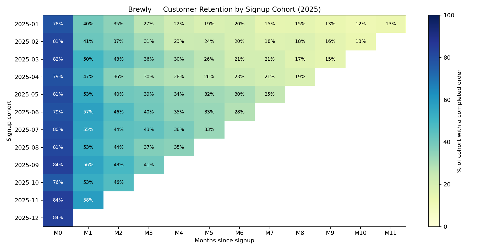

# Customer Retention Cohort Analysis — Brewly (SQL)



## TL;DR
In this project, I cleaned 11k rows of messy subscription data and built cohort retention analysis in SQL. Key findings from this exercise include customers from referrals were ratained better than the other acquisition channels with the largest difference being 23.7% in M1 and 34.1% in M3. When splitting the cohorts into January-May and June-November I found an increase in retention by 9%. At first I thought it was due to the aquisition mix but it was stable throughout the year. Another possibility is seasonality but there is not enough data.

## Business question
Brewly's Growth team wanted to know whether newly acquired customers stick around, which acquisition channels bring the most loyal customers, and whether retention is improving over time.

## Data
- **Source:** raw production export (fictional) — `users` (2,603 raw rows) and `orders` (8,861 raw rows), Jan–Dec 2025
- **After cleaning:** 2501 users and 8410 orders

## Data cleaning
I profiled the raw data before changing anything and found **16** issues:

| Issue | Rows affected | Fix |
|---|---|---|
| <!-- e.g. Duplicate user records from re-imports --> | <!-- 75 --> | <!-- ROW_NUMBER() dedupe on user_id --> |
| | | |

Validation: compared cleaned tables against a reference dataset with `EXCEPT` — 0 mismatched rows.

## Methodology
- **Cohort:** users grouped by signup month
- **Retained in month N:** at least one *completed* order N calendar months after the signup month (refunded/cancelled orders excluded)
- **Cohort size:** all signups, including users who never ordered
- **Channel comparison:** limited to cohorts with ≥3 months of history to avoid comparing mature and immature cohorts

## Key findings
1. **Referrals is the leading acquisition channel for retention** — 63.1% in M1 and 53.9% in M3
2. **Revenue retention falls in line with customer retention** — Brewly uses fixed pricing, losing customers is almost 1:1 to loss revenue. Brewly does not have upsell or expansion opportunities 
3. **Country and signup device used is negligible on retention** — Retention was relatively the same when comparing the country to the signup device
## Recommendations
- I would advise Brewly to focus resources and time into email campaign and organic marketing, less on paid social.
- First I would start by looking at the Brewly ticketing system and customer support to understand where customer are most frustrated and how the team addresses those issues. From there I would suggest changes to improve the customer experience and increase retention.

## Limitations & next steps
The limitations in this project include only 12 months of data, no information on customer support and no information on the other product lines and revenue stream. No cost data, so channel ROI can't be computed. 
Next steps would be to calculate LTV/CAC and to understand customer demographics.

## How to reproduce
```bash
pip install duckdb
duckdb brewly.duckdb < sql/00_setup.sql
duckdb brewly.duckdb < sql/02_load_clean.sql
duckdb brewly.duckdb < sql/04_cohort_retention.sql
```

## Skills demonstrated
SQL (CTEs, window functions, date arithmetic, conditional aggregation/pivoting) · data profiling & cleaning · data validation · cohort analysis · communicating insights ·Python
